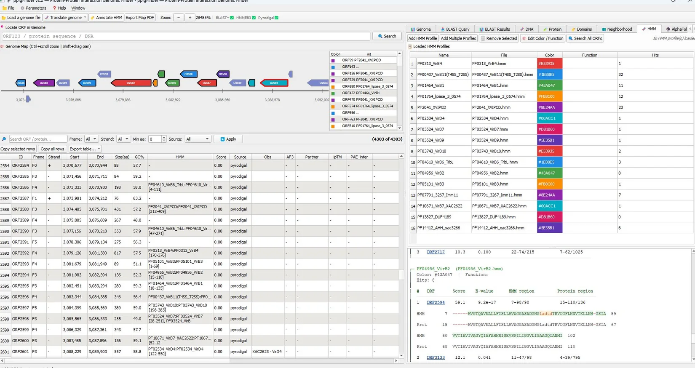
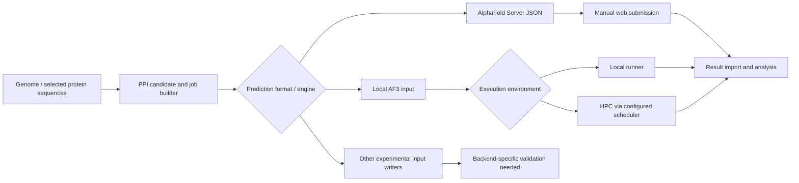

<div align="center">

# ppigFinder

**Protein–Protein Interaction Genomic Finder**

**From bacterial genomes to biologically informed protein–protein interaction candidates.**

[](LICENSE)
[](pyproject.toml)
[](docs/user_manual/installation.md)
[](https://leepusp.github.io/ppigFinder-v1/)
[](https://doi.org/10.64898/2026.08.23.746524)

[**Install**](#install-from-source) · [**Features**](#what-you-can-do) · [**Screenshots**](#interface-gallery) · [**Workflow**](#scientific-workflow) · [**Manual**](https://leepusp.github.io/ppigFinder-v1/) · [**Paper**](https://doi.org/10.64898/2026.08.23.746524)


*Conceptual workflow diagram. Execution backends are optional; structural prediction is not required for genome annotation.*

</div>

ppigFinder is an open-source desktop application designed to connect **bacterial genome exploration**, **functional annotation**, **genomic-neighborhood reasoning**, **candidate interaction design**, and **structural-prediction result interpretation**. The application is written in Python and includes a PyQt interface. Researchers can prepare input for **AlphaFold Server** without a cluster, or configure local and remote execution separately when appropriate.

> **Release scope.** This repository includes the application imported from `leepusp/ppigfinder` (software metadata v2.9.14), plus new visual documentation. The diagrams are explanatory; screenshots from the supplied guide show an **earlier v2.2 interface**, and do not certify every control in v2.9.14. Verify optional tools and HPC workflows against your local installation.

## What you can do

| | Capability | Typical use |
|:---:|---|---|
| 🧬 | **Genome input and ORF prediction** | Load bacterial sequence data, predict coding sequences with Pyrodigal or alternate strategies, and inspect protein products. |
| 🔎 | **Sequence and domain annotation** | Find homologs with BLAST+ and domains with HMMER, including fallback components where supported. |
| 🧭 | **Genomic context** | Explore nearby ORFs and prioritize biologically motivated interaction candidates. |
| 🧩 | **PPI job design** | Build selected pairs, neighborhood screens, homodimers and custom protein-chain combinations. |
| 🌐 | **AlphaFold Server export** | Generate server-compatible JSON and submit manually through the website, without requiring HPC. |
| 🖥️ | **AF3 / compute workflows** | Prepare native AF3 inputs and optional cluster scripts, subject to runner and scheduler configuration. |
| 📈 | **Structural-confidence analysis** | Import result directories and review ipTM, PAE, scores and interface/contact summaries where available. |
| 📂 | **Reproducible outputs** | Export FASTA, tables, jobs and project artifacts for further analysis. |

**Important:** tools, profiles, and experimental modules are not all equivalent to a fully validated end-to-end workflow. See [implemented vs planned](docs/developer/feature_status.md).

## Interface gallery

The images below come from the **earlier user guide (ppigFinder v2.2)**. They document the UI lineage but may differ from the current packaged v2.9.14 build. For a structure schematic, see [interface tour](docs/user_manual/interface_tour.md).

| Genome and predicted ORFs | BLAST inspection |
|---|---|
| [](docs/assets/screenshots/legacy-orf-prediction.webp) | [](docs/assets/screenshots/legacy-blast.webp) |
| HMM/domain annotation | Structural job creation |
| [](docs/assets/screenshots/legacy-hmmer.webp) | [](docs/assets/screenshots/legacy-af3-pairs.webp) |

## Install from source

**Required:** Python **3.11+**, a graphical desktop and a local virtual environment. Local AF3 inference is optional; the app does not ship model parameters, databases or inference executables.

### Linux / macOS

```bash
git clone https://github.com/leepusp/ppigFinder-v1.git
cd ppigFinder-v1
bash scripts/install_ppigfinder.sh
.venv/bin/python main.py
```

### Windows PowerShell

```powershell
git clone https://github.com/leepusp/ppigFinder-v1.git
cd ppigFinder-v1
powershell -ExecutionPolicy Bypass -File .\scripts\install_ppigfinder.ps1
.\.venv\Scripts\python.exe main.py
```

These are **documented source-install commands, not yet a formally validated installer**. BLAST+ and HMMER must be installed separately if you need their external executables. For platform-specific issues, see [installation](docs/user_manual/installation.md) and [troubleshooting](docs/user_manual/troubleshooting.md).

## Scientific workflow

1. **Load a bacterial genome**, for example *Xanthomonas citri* strain 306 (NCBI `AE008923.1`).
2. **Predict ORFs** and inspect genomic coordinates and protein sequences.
3. **Annotate** candidates by sequence similarity and HMM-profile searches.
4. **Inspect neighborhoods** and choose interaction hypotheses.
5. **Generate selected pairs or complexes** and export them in a format suitable for the chosen prediction backend.
6. **Run externally or on available compute**; for AlphaFold Server, the upload step remains manual.
7. **Import structural predictions**, evaluate confidence metrics, and report results with genomic context.

The preprint reports 4,303 predicted chromosomal ORFs in the demonstration dataset and a VirD4-centered screening strategy. These are **study-specific results**, not hard-coded outputs of the software. See the [walkthrough](docs/tutorials/xanthomonas.md) and [preprint](https://doi.org/10.64898/2026.08.23.746524).

## Prediction and execution are separate decisions



**No DaVinci requirement.** The project can be used for core genomic analysis without a GPU, remote SSH access or Slurm. The `davinci` profile is an optional example of institutional infrastructure. Some HPC integration modules are still placeholders; see [execution architecture](docs/developer/feature_status.md).

## Documentation

| Guide | Coverage |
|---|---|
| [Complete user guide](docs/user_manual/complete_guide.md) | Setup, genomes, ORFs, annotation, interaction jobs, export and interpretation. |
| [Interface tour](docs/user_manual/interface_tour.md) | Annotated schematic and historical screenshots. |
| [Xanthomonas tutorial](docs/tutorials/xanthomonas.md) | Reproducible study-inspired walkthrough. |
| [AlphaFold Server and AF3](docs/user_manual/alphafold.md) | Distinct JSON dialects, manual server submission and result import. |
| [AF3 install and local runner](docs/user_manual/af3_local_installation.md) | Native AF3 export, optional official/Docker/wrapper inference, CLI and GUI setup. |
| [Local / HPC execution](docs/user_manual/hpc_submission.md) | Optional compute configuration and validation checks. |
| [Optional remote connections](docs/user_manual/remote_connections.md) | User-owned SSH profiles, verified SFTP uploads/downloads; no job submission. |
| [Implementation status](docs/developer/feature_status.md) | Implemented, provisional and not-yet-validated pathways. |
| [Website](https://leepusp.github.io/ppigFinder-v1/) | Public, searchable MkDocs documentation. |

## Repository layout

```text
ppigFinder-v1/
├── ppigfinder/               # application modules and GUI
│   ├── bioseq/ annotation/ neighborhood/
│   ├── alphafold/ structure_prediction/
│   ├── services/ ui/ hpc/ integrations/af3/
│   └── ...
├── scripts/                  # developer checks and optional runner templates
├── docs/                     # manuals, diagrams and historical screenshots
├── main.py                   # desktop entry point
├── pyproject.toml            # package metadata and optional dependencies
├── CITATION.cff / LICENSE    # attribution and MIT license
└── mkdocs.yml                # documentation portal
```

## Citation, development and license

- **Paper:** Oka, Adan, Calomeno & de Souza (2026). *ppigFinder: an integrated desktop application for bacterial genome annotation and AlphaFold 3-based protein–protein interaction screening*. **bioRxiv**, [doi:10.64898/2026.08.23.746524](https://doi.org/10.64898/2026.08.23.746524).
- **Software:** use [`CITATION.cff`](CITATION.cff) for software-version author metadata.
- **Source of historical versions:** [`leepusp/ppigfinder`](https://github.com/leepusp/ppigfinder). This repository is the v1 public distribution line.
- **License:** [MIT](LICENSE). External tools, models, and databases retain their own licenses; neither AF3 weights nor proprietary databases are bundled.
- **Contributing:** [CONTRIBUTING.md](CONTRIBUTING.md) · **Security:** [SECURITY.md](SECURITY.md) · **Changelog:** [CHANGELOG.md](CHANGELOG.md).
