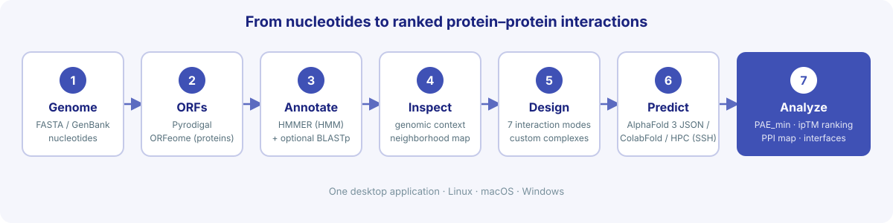
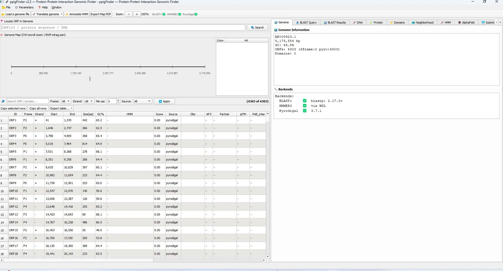
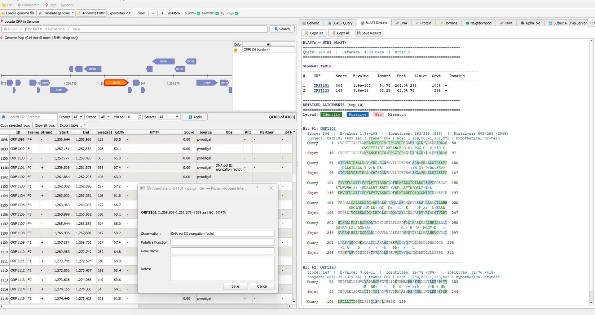
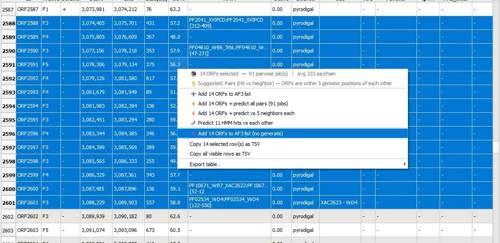

<div align="center">

# ppigfinder

**Protein–Protein Interaction Genomic Finder**

[](LICENSE)
[](pyproject.toml)
[](docs/user_manual/installation.md)
[](https://leepusp.github.io/ppigfinder/)
[](https://doi.org/10.64898/2026.08.23.746524)

[Install](#install) · [Screenshots](#interface-gallery) · [Manual](https://leepusp.github.io/ppigfinder/)



</div>

ppigfinder is a desktop application for exploring bacterial genomes and prioritizing protein–protein interaction candidates. It runs on Windows, Linux and macOS.

## What it does

- Load genomes and predict open reading frames (ORFs).
- Annotate proteins with BLAST+ and HMMER and inspect genomic neighborhoods.
- Build protein pairs and complexes, export AlphaFold Server or native AlphaFold 3 inputs, and import structural results.
- Transfer files over SFTP and manage jobs from a configured Slurm host.

Genome analysis and input preparation run locally. Structural inference needs a configured prediction engine and its data.

## Interface gallery

Screenshots from the v2.2 user guide. See the [interface tour](docs/user_manual/interface_tour.md) for the current layout.

| Genome and ORFs | BLAST results |
| --- | --- |
| [](docs/assets/screenshots/legacy-orf-prediction.webp) | [](docs/assets/screenshots/legacy-blast.webp) |
| **HMM annotation** | **AlphaFold job design** |
| [](docs/assets/screenshots/legacy-hmmer.webp) | [](docs/assets/screenshots/legacy-af3-pairs.webp) |

## Install

**Conda or Mamba** (run from a source checkout):

```bash
git clone https://github.com/leepusp/ppigfinder.git
cd ppigfinder
conda create -n ppigfinder -c conda-forge python=3.11 pip
conda run -n ppigfinder python -m pip install ".[gui,recommended]"
conda run -n ppigfinder ppigfinder
```

Replace `conda` with `mamba` in these commands if you use Mamba. The [installation guide](docs/user_manual/installation.md) also covers the downloadable wheel, the graphical installer and Python virtual environments.

## Documentation

- [User guide](docs/user_manual/complete_guide.md) and [worked example](docs/tutorials/xanthomonas.md)
- [AlphaFold 3 setup](docs/user_manual/af3_local_installation.md) and [Slurm execution](docs/user_manual/hpc_submission.md)
- [Project status](docs/developer/feature_status.md) and [contributing](CONTRIBUTING.md)

## Citation and license

Cite the software using [CITATION.cff](CITATION.cff). The workflow is described in the [bioRxiv preprint](https://doi.org/10.64898/2026.08.23.746524). ppigfinder is released under the [MIT License](LICENSE).
