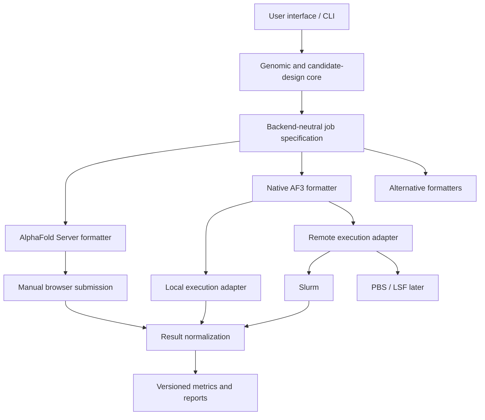

# Feature status and portability contract

**Status snapshot: 20 November 2026** — based on the imported v2.9.14 software architecture, previous DaVinci wrapper dry-run records and source inspection. A module being present is **not** proof of complete integration in the packaged GUI.

## What is present in source

| Component | Evidence in repository | Release interpretation |
|---|---|---|
| Genome input, ORF prediction | `ppigfinder/bioseq/`, `io/`, `ui/` | Code exists and legacy GUI offers associated workflow; reproducibility depends on backend versions |
| BLAST/HMMER annotation | `annotation/`, `services/`, UI modules | External executables optional; fallback behavior differs from full search backends |
| Genomic neighborhood | `neighborhood/`, UI modules | Candidate-prioritization concept supported; not direct PPI evidence |
| AlphaFold Server JSON export | `alphafold/server_json.py`, `services/alphafold_service.py` | JSON export capability; web submission remains manual |
| Native AF3 protein JSON | `structure_prediction/af3_input_writer.py` | Protein-only initial native writer; not equivalent to full AF3 molecule support |
| Local wrapper commands | `alphafold/af3_cli.py`, `services/alphafold_service.py` | Command construction and subprocess execution; requires an available wrapper |
| Slurm scripts / arrays | `structure_prediction/slurm_batch_writer.py`, `slurm_renderer.py` | Script generation; inspect resource mapping and backend commands before production |
| DaVinci AF3 | `hpc/profiles/davinci.py`, docs of dry-run | Institution-specific example; input/wrapper dry-run recorded, not real inference in that particular test |
| Result parsing | `alphafold/result_parser.py`, `services/alphafold_results_service.py` | Sequential/parallel parsing code; supported metrics depend on output format |
| Boltz-2 / FoldCP | `structure_prediction/*_input_writer.py` | Input scaffolding; job-runner code contains TODOs |
| SSH/SFTP and monitoring | `hpc/ssh_client.py`, `services/hpc_service.py`, `hpc/job_monitor.py` | Some of these files are empty; **automated remote round-trip not yet substantiated** |
| Cross-platform packaging | `pyproject.toml`, `main.py`, PyQt launcher | Source install is documented; fresh OS install matrix needs verification |

## Architectural boundary (recommended)

**Prediction format ≠ execution environment.** A new cluster profile must not require modifications to the scientific gene/ORF/PPI logic. The AlphaFold Server JSON dialect must remain independent from the native AF3 dialect.

## Release readiness gates

- **Required:** the GUI starts in a fresh Python 3.11 desktop environment on each claimed OS; a sample genome can be loaded, ORFs predicted, and the project saved/reopened.
- **Required:** server JSON exports validate against the current AlphaFold Server accepted schema, and imported result files correctly map back to selected protein sequences.
- **Required before marking an HPC target supported:** preflight commands, secure authentication, resource mapping, non-nested Slurm job execution, monitoring, log collection and failure/retry handling are tested with a small real job.
- **Required:** no secrets, personal paths or institutional datasets are bundled into public files; external licenses are honored.
- **Recommended:** reproducible end-to-end fixture (a small FASTA + expected outputs), CI smoke tests, model-format fixture tests, documented benchmark results and current-version UI screenshots.

These gates are a **roadmap**, not an assertion that all are passing.
