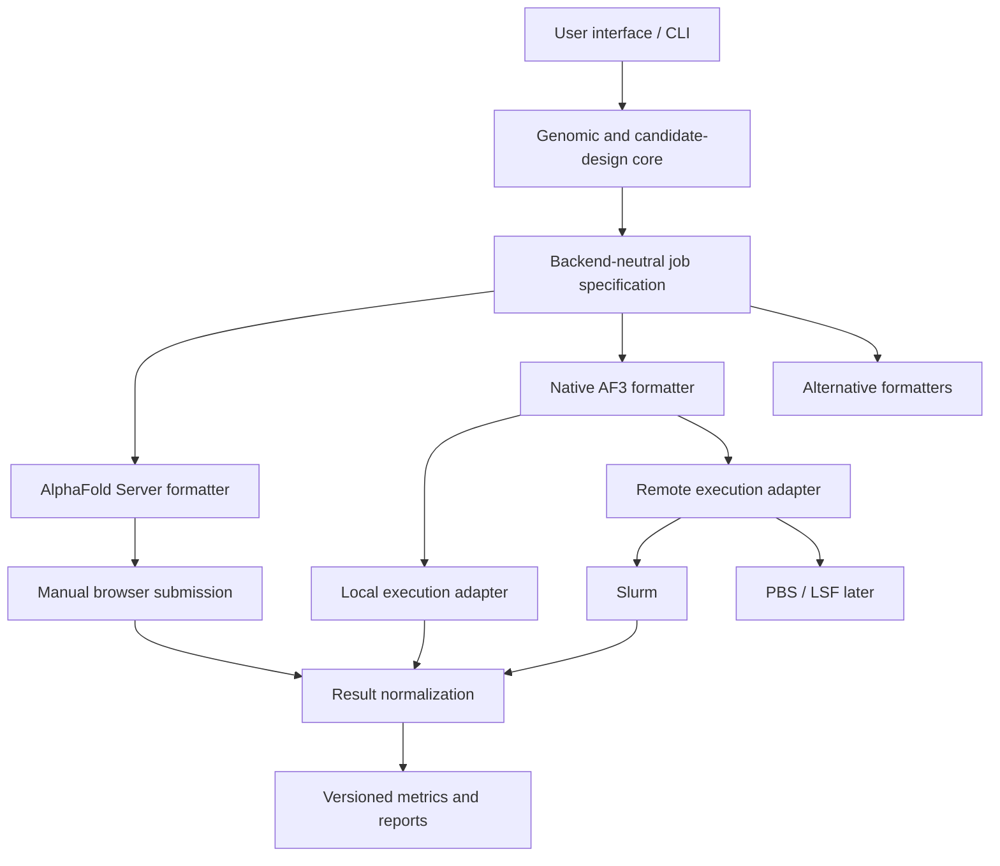

# Feature status and portability contract

**Status snapshot: 20 November 2026** — based on the imported v2.9.14 software architecture, source inspection. A module being present is **not** proof of complete integration in the packaged GUI.

## What is present in source

| Component | Evidence in repository | Release interpretation |
|---|---|---|
| Genome input, ORF prediction | `ppigfinder/bioseq/`, `io/`, `ui/` | Code exists and legacy GUI offers associated workflow; reproducibility depends on backend versions |
| BLAST/HMMER annotation | `annotation/`, `services/`, UI modules | External executables optional; fallback behavior differs from full search backends |
| Genomic neighborhood | `neighborhood/`, UI modules | Candidate-prioritization concept supported; not direct PPI evidence |
| AlphaFold Server JSON export | `alphafold/server_json.py`, `services/alphafold_service.py` | JSON export capability; web submission remains manual |
| Native AF3 protein JSON | `structure_prediction/af3_input_writer.py` | Protein-only initial native writer; not equivalent to full AF3 molecule support |
| Local wrapper commands | `alphafold/af3_cli.py`, `services/alphafold_service.py` | Command construction and subprocess execution; requires an available wrapper |
| Slurm scripts / arrays | `structure_prediction/slurm_batch_writer.py`, `slurm_renderer.py` | Script generation; inspect resource mapping and backend commands before production |
| Result parsing | `alphafold/result_parser.py`, `services/alphafold_results_service.py` | Sequential/parallel parsing code; supported metrics depend on output format |
| Boltz-2 / FoldCP | `structure_prediction/*_input_writer.py` | Input scaffolding; job-runner code contains TODOs |
| SSH/SFTP | `integrations/remote/` | Optional, checksum-verified transfers with strict host-key checks. GUI round-trip has been tested on one host. |
| Slurm operations | `hpc/slurm.py`, `hpc/cli.py` | Script validation, submission, status, log paths and cancellation on a Slurm host. Command handling is covered by offline tests. |
| Cross-platform packaging | `pyproject.toml`, `main.py`, PyQt launcher | Source install is documented; fresh OS install matrix needs verification |

## Architectural boundary (recommended)

**Prediction format ≠ execution environment.** A new cluster profile must not require modifications to the scientific gene/ORF/PPI logic. The AlphaFold Server JSON dialect must remain independent from the native AF3 dialect.

## Release readiness gates

- **Required:** the GUI starts in a fresh Python 3.11 desktop environment on each claimed OS; a sample genome can be loaded, ORFs predicted, and the project saved/reopened.
- **Required:** server JSON exports validate against the current AlphaFold Server accepted schema, and imported result files correctly map back to selected protein sequences.
- **Required before marking an HPC target supported:** preflight commands, secure authentication, resource mapping, non-nested Slurm job execution, monitoring, log collection and failure/retry handling are tested with a small real job.
- **Required:** no secrets, personal paths or institutional datasets are bundled into public files; external licenses are honored.
- **Recommended:** reproducible end-to-end fixture (a small FASTA + expected outputs), CI smoke tests, model-format fixture tests, documented benchmark results and current-version UI screenshots.

These gates are a **roadmap**, not an assertion that all are passing.

## Native AF3 integration (2026-11-20)

The optional `ppigfinder/integrations/af3/` adapter now supports protein FASTA
conversion to **native one-object** AF3 JSON, local preflight, official
`run_alphafold.py`, Docker and compatible institutional wrapper **execution on
explicit opt-in**. AF3 itself, model parameters and databases are separate
external prerequisites. Container/runtime/GPU effectiveness has not been
validated end-to-end on every platform. AlphaFold Server manual JSON export
remains independent. Refer to the [AF3 setup manual](../user_manual/af3_local_installation.md).

## Opt-in execution contract (2026-11-20)

Scientific job input preparation now defaults to `execution_mode="export_only"`;
this requires neither SSH nor Slurm. `execution_mode="slurm"` is an explicit
opt-in for a configured scheduler profile. Unconfigured GPU resources fail
before a scheduler script is produced. The available AF3 wrapper must be
supplied by the execution environment, rather than loaded through an assumed
institutional module. Boltz-2 and FoldCP export inputs but do not execute;
their placeholder runner scripts fail explicitly with exit code 78.

**Implemented separately:** optional SSH/SFTP connection profiles, strictly
verified single-file transfer and AF3 command preview. **Not implemented:**
job submission and monitoring over SSH from the GUI, or PBS and LSF adapters.
AlphaFold Server remains a separate manual workflow. See the
[remote connections guide](../user_manual/remote_connections.md).
