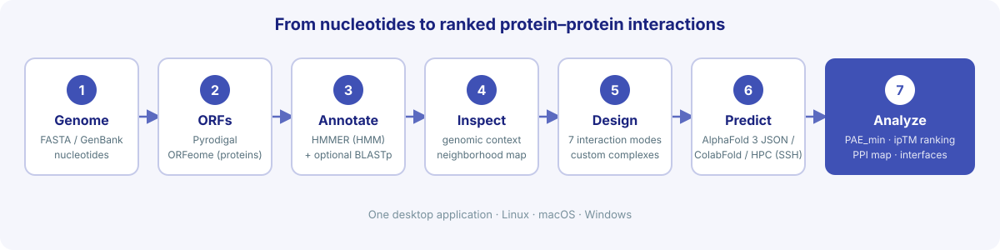
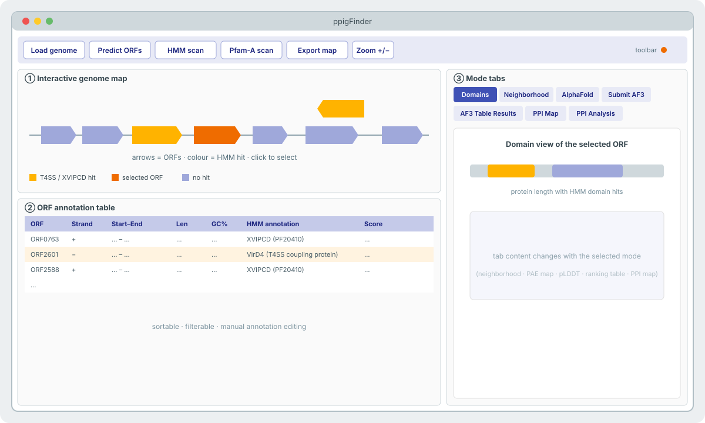
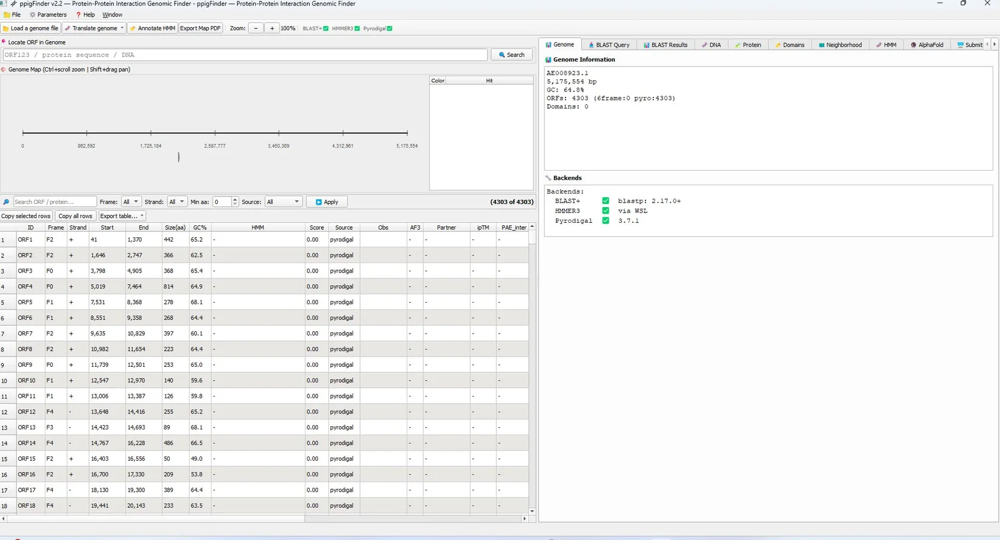
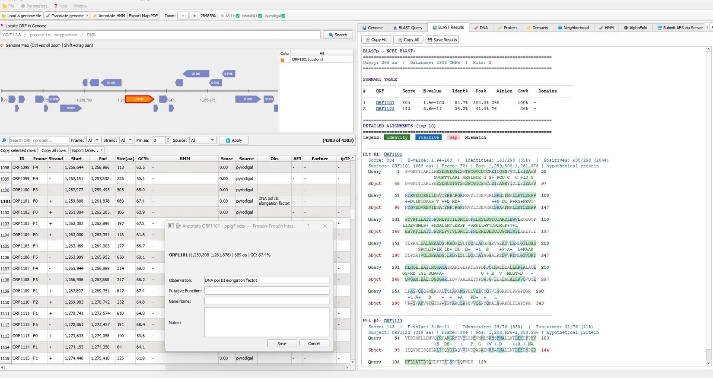

OPEN-SOURCE · BACTERIAL GENOMICS · STRUCTURAL BIOINFORMATICS

# ppigFinder

## From genome sequences to interaction hypotheses

A project-oriented desktop application for ORF prediction, functional annotation, genomic-context exploration and preparation of protein–protein interaction screens.

[**Start the tutorial**](tutorials/xanthomonas.md){ .md-button .md-button--primary }
[**Install ppigFinder**](user_manual/installation.md){ .md-button }
[**Browse source**](https://github.com/leepusp/ppigFinder-v1){ .md-button }

Python / PyQt · BLAST+ · HMMER · AlphaFold Server export · Optional HPC

*Workflow diagram, not a statement that every external tool or execution target is preinstalled.*

## One scientific workflow, multiple execution choices

-   :material-dna: **Genome and ORFs**

    Load sequence files, predict ORFs and inspect the interactive genome map.

    [Genome and ORFs](user_manual/orf_prediction.md)

-   :material-magnify: **Annotation**

    Explore candidate homologs, domains, operon-like context and neighborhood windows.

    [BLAST, HMMER and context](user_manual/annotation.md)

-   :material-layers-triple: **Design PPI screens**

    Select neighboring ORFs, pairwise sets, homodimers and custom protein multichain jobs.

    [PPI job builder](user_manual/alphafold.md)

-   :material-web: **AlphaFold Server export**

    Generate server-dialect JSON, upload it in a browser and import completed results.

    [Server guide](user_manual/alphafold.md#alphafold-server-manual-web-workflow)

-   :material-server-network: **Optional local/HPC compute**

    Prepare native AF3 inputs and optional scripts; adapt profiles to local or remote resources.

    [Execution environments](user_manual/hpc_submission.md)

-   :material-chart-scatter-plot: **Inspect confidence**

    Explore predicted interfaces through ipTM, PAE and contact metrics in biological context.

    [Results and reporting](user_manual/reports.md)

## Explore the graphical interface

<figure class="pf-figure" markdown>

<figcaption>Illustrated interface layout. For genuine screenshots, browse the historical gallery below.</figcaption>
</figure>

*Screenshots reproduced from the supplied **v2.2 user guide**. Navigation and controls may differ in the imported v2.9.14 code.*

## A peer-reviewed article is not required to use the tool

The ppigFinder proof of concept is described in a 2026 bioRxiv preprint by Oka, Adan, Calomeno and de Souza. Its *Xanthomonas citri* VirD4 example illustrates candidate prioritization; the structural predictions are evidence to interpret, **not automatic experimental confirmation of PPIs**.

[Read the preprint](https://doi.org/10.64898/2026.08.23.746524){ .md-button }
[Reproduce the tutorial](tutorials/xanthomonas.md){ .md-button }

!!! info "Distribution scope"
    The software source ships in this repository. AlphaFold 3 weights/databases and external sequence-analysis executables are **not bundled**. AlphaFold Server can be used through manual JSON export without a cluster. Current HPC and additional model integrations differ in maturity: see the [implementation status](developer/feature_status.md).
