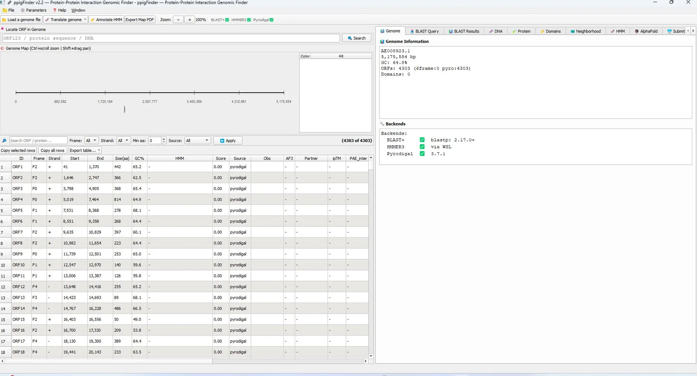

# Tutorial: *Xanthomonas citri* strain 306

This is a **study-inspired guide** based on the original ppigFinder manual and the [2026 bioRxiv preprint](https://doi.org/10.64898/2026.08.23.746524). It describes the experimental design and provides reproducibility checkpoints; it does **not** contain bundled AF3 predictions or guarantee reproduction of the published screening ranks without the exact data and computational parameters.

## Biological question

Which bacterial proteins represent plausible candidate partners for the VirD4 coupling protein in the type IV secretion system of *X. citri* pv. citri strain 306?

The preprint describes modeling a VirD4-centered screen against **4,303 predicted chromosomal ORFs**. It reports all **14 XVIPCD-containing candidates** among the **top 1%** when ranked by minimum interchain predicted aligned error (`PAE_min`), with the six top-ranked models belonging to XVIP candidates. These are **reported study findings**, not independently regenerated in this walkthrough.

## Step 1 — Source and preserve the reference genome

Download accession [AE008923.1](https://www.ncbi.nlm.nih.gov/nuccore/AE008923.1) from NCBI as nucleotide FASTA. Keep the accession, download date and SHA-256 checksum in the project record. The older manual used the same accession.

## Step 2 — Predict the ORFeome

Use the Pyrodigal option from the genome translation menu and save the predicted protein FASTA and ORF table. Compare method defaults with those used in the original analysis. The 4,303 value is a **reported example**, so a different count needs investigation rather than silent adjustment.

## Step 3 — Annotate candidates

Use BLAST+ and HMMER profiles to identify putative type IV secretion proteins and any XVIPCD-related annotations. Report accession, domain cutoffs, coverage and multiple hits. Avoid equating a domain label with experimental functional validation.

## Step 4 — Create a biologically structured pair set

Choose a VirD4 bait and define a list of predicted prey proteins. Retain negative controls, suspected false positives, sequence lengths and domain boundaries where possible. Whole-proteome screening has very different compute requirements from a targeted 16-protein demonstration:

| Setup | Pair count | Purpose |
|---|---:|---|
| 16 selected proteins, unordered no-self-pairs | 120 | Local selected-set illustration |
| 1 VirD4 bait × 4,303 prey ORFs | 4,303 | Paper-scale bait-centered screen (if all included) |

These are **different experimental designs** and must not be conflated.

## Step 5 — Choose an execution path

For a small set, export JSON for [AlphaFold Server](../user_manual/alphafold.md#alphafold-server-manual-web-workflow) and manually upload compatible jobs. For a larger dataset, native AF3 runs may be prepared for an appropriately configured compute environment. Neither route is automatically configured merely by cloning the repository.

## Step 6 — Evaluate the structural evidence

Review confidence fields such as `PAE_min`, ipTM, model ranking, interface contacts and reproducibility between model seeds. Document the exact definition of `PAE_min` and any transformations used for ranking. Model confidence must be interpreted with biological context.

## Step 7 — Export an auditable result set

Preserve the original FASTA and checksum; ORF table; HMM/BLAST source versions; candidate manifest; native/server JSON; model settings and seeds; results; confidence tables; and scripts used for aggregation. This makes it possible to distinguish published evidence, new results and exploratory interpretations.

**Publication:** Oka GU, Adan C, Calomeno CVAQ, de Souza RF. *ppigFinder: an integrated desktop application for bacterial genome annotation and AlphaFold 3-based protein–protein interaction screening.* bioRxiv (2026). DOI: [10.64898/2026.08.23.746524](https://doi.org/10.64898/2026.08.23.746524).
