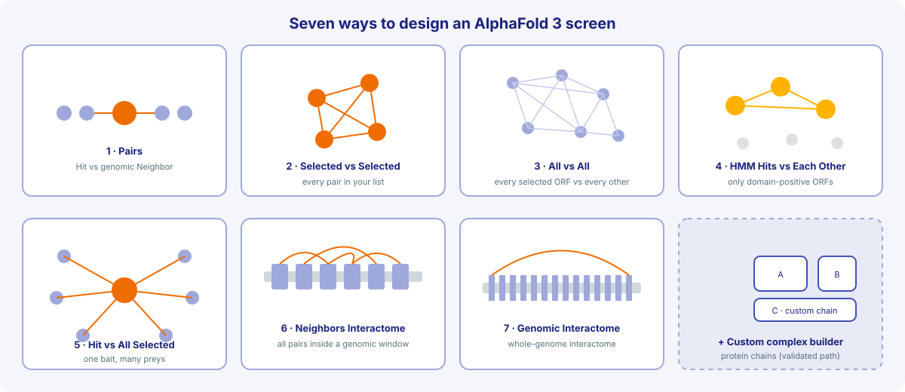

# Protein interactions and structural prediction

The structural-prediction feature is a **candidate-generation and analysis workflow**, not an automatic experimental PPI assay. Choose a **prediction format/engine** separately from the **execution environment**.

## Generate biologically motivated pairs

After predicting ORFs and loading annotations, use the AlphaFold/PPI area to select protein sequences or candidate genomic neighborhoods. The user guide describes:

- selected proteins or manually chosen pairs;
- pairwise combinations within a selected set;
- one selected protein against its neighbors;
- HMM-positive candidate sets;
- homodimers and custom multichain protein stoichiometries;
- larger neighborhood or genome-wide screens, where computationally justified.



The figure is an **illustration of screening strategies from the preliminary guide**. Exact menu choices and availability vary by version. It is not proof that all seven modes are implemented in each interface.

### Example: 16 candidate proteins

For 16 distinct proteins, the number of unique undirected pairwise combinations **excluding self-pairs** is `16 × 15 / 2 = 120`. A screen of 120 predictions is not equivalent to 120 validated biological interactions. In the original guide these proteins were chosen from a putative T4SS-associated set.

## AlphaFold Server: manual web workflow

This is the most accessible option when the user **does not have a cluster or local AF3 installation**.

1. Add the intended protein sequences or complexes to the PPI job list.
2. Use the appropriate **AlphaFold Server JSON export** from the UI.
3. Inspect sequence lengths, chain identifiers, stoichiometry and predicted job count.
4. Open [AlphaFold Server](https://alphafoldserver.com/) in a browser; authenticate and verify the service's current permitted inputs and limits.
5. Submit compatible jobs manually as accepted by the website.
6. Download resulting structures and confidence files, and import the completed result folders into ppigFinder.

**Do not interchange server-dialect JSON and native AF3 JSON without checking the corresponding schema.** Current service terms, size and daily limits may change; no static quota is guaranteed here. This workflow makes **no claim of an official automatic server-submission API**.

## Local AlphaFold 3 and HPC workflow

The modular backend has an `af3_input_writer.py` with support for protein sequences in native AF3 input format. It can generate `af3_input.json`, task tables, and Slurm scripts. The command-line wrapper is **not** the upstream AF3 executable itself; it requires an appropriate installed backend and validated command-line options.

```
PPI candidates
  → native AF3 job specifications
  → AF3 JSON + manifest
  → local executor OR optional HPC scheduler
  → result folders
  → parsing and confidence summaries
```

The structural Slurm script currently calls an `af3` wrapper inside a Slurm allocation, typically using `--executor local` to avoid nested submissions. **These scripts must be reviewed against your actual cluster policy before production execution.**

For details, see [execution targets](hpc_submission.md) and [implementation status](../developer/feature_status.md).

## Other prediction engines

The codebase contains scaffolding for **Boltz-2** and **FoldCP** input generation. Corresponding Slurm scripts still contain TODO runner placeholders, and these should not be represented as fully operational validated inference backends. The architecture aims to make additional engines installable without changing the main genomics workflow.

The current generic native AF3 writer supports **protein targets**. Do not infer production support for arbitrary DNA, RNA or ligand complexes from conceptual figures.

## Import and interpret results

Available parsing/service components include sequential and parallel loading of AF3 output directories. Depending on data and model version, reported fields can include:

| Metric | Interpretation caveat |
|---|---|
| pTM | Confidence in global relative structure/topology |
| ipTM | Model-derived confidence for interchain placement |
| PAE / interchain PAE | Predicted alignment error; lower interface-associated values may suggest more confident relative placement |
| Ranking score | Depends on model/software version and should be recorded with its definition |
| Contact fraction and hotspot summaries | Geometry-dependent; sensitive to threshold, model, atom selection and chain mapping |

Structural confidence is **not a direct binding-affinity measurement**. Consider sequence length, disordered regions, cofactors, genomic context, competing interaction models, and experimental validation. When reporting, preserve PDB/mmCIF files, model settings, JSON manifests and software versions.

## Related documentation

[Complete user guide](complete_guide.md) · [Results](reports.md) · [Xanthomonas case](../tutorials/xanthomonas.md)
