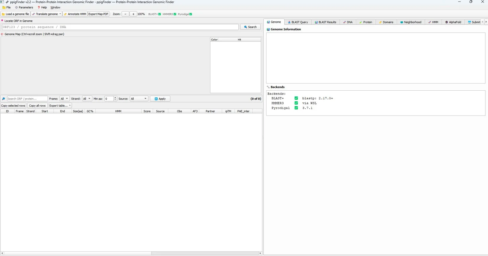
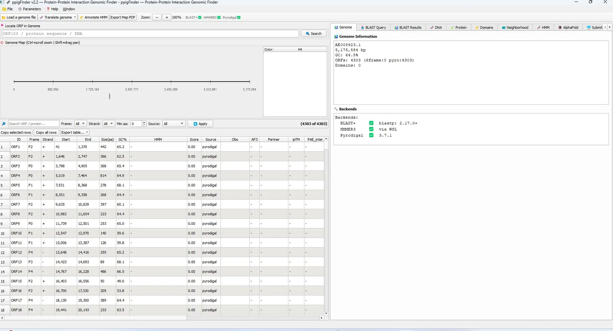
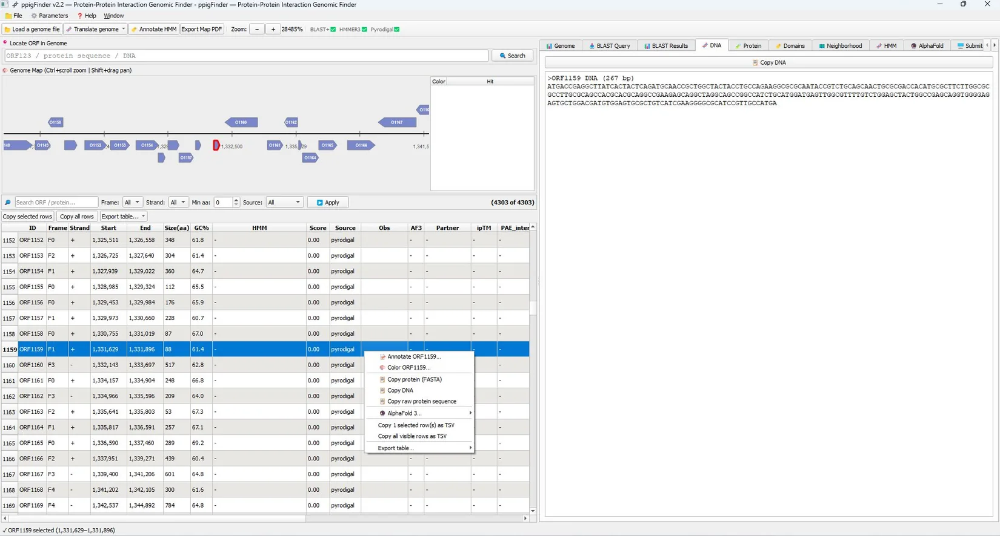
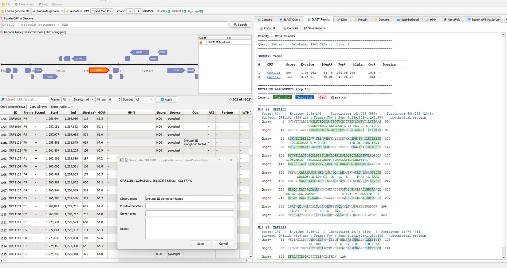
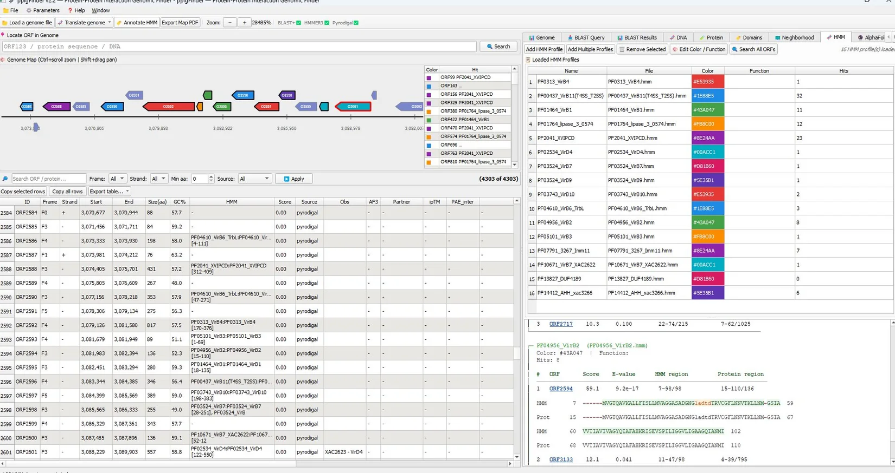
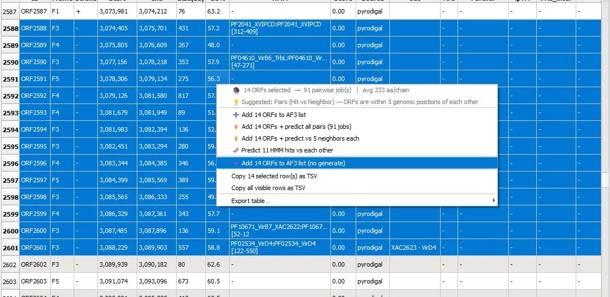
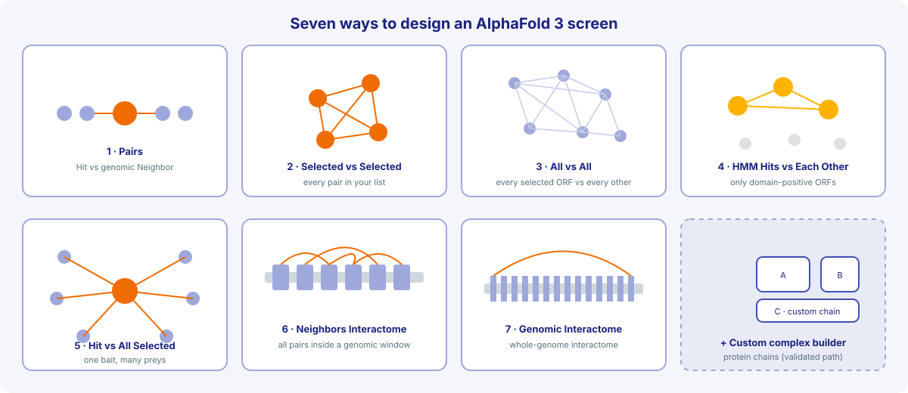

# Complete user guide

**ppigFinder — Protein–Protein Interaction Genomic Finder**

This guide consolidates the user-supplied preliminary 27-page slide manual, the packaged source code and the public documentation. It focuses on a **reproducible, guided scientific workflow**: genome → ORFs → annotation → candidate selection → structural job preparation → confidence analysis. Screen names and positions may vary across versions; the historical screenshots below were extracted from the **v2.2 manual**. The current codebase identifies software version 2.9.14 in package metadata.

## 1. Scientific scope and limitations

ppigFinder supports *hypothesis generation* for bacterial PPIs. It can analyze nucleotide sequences, predict open reading frames, identify putative homologs/domains, inspect genomic context, build structural prediction jobs and parse selected outputs. It does not replace experimental evidence of physical binding, functional genetics or biochemical characterization.

**Software dependencies are modular:** genomic analysis does not require Slurm, HPC, AF3 inference or a GPU. The AlphaFold Server route allows manually uploading compatible JSON jobs when compute resources are not available.

## 2. Install and check your environment

Follow the [platform-specific installation guide](installation.md). Use a local Python 3.11 virtual environment as the conservative starting point:

```bash
git clone https://github.com/leepusp/ppigFinder-v1.git
cd ppigFinder-v1
python3.11 -m venv .venv
source .venv/bin/activate
python -m pip install -e ".[gui,recommended]"
python main.py
```

On Windows, use `py -3.11 -m venv .venv`, activate the environment with PowerShell or run `.venv\Scripts\python.exe` directly, then run `python main.py`.

If the GUI does not open, first verify that you have a graphical desktop and PyQt6 is installed. On remote Linux login nodes, lack of an active display can cause Qt/xcb failures even if the Python code is otherwise valid.

Optional backend indicators report which utilities are detected locally. For example, BLAST+ and HMMER3 must be available in the executable `PATH` (or through the configured backend) to run their external search modes.



*Historical v2.2 window, shown to explain the layout, not to assert the current UI is identical.*

## 3. Obtain a genome

For the worked example, use *Xanthomonas citri* strain 306, accession **AE008923.1**, from [NCBI Nucleotide](https://www.ncbi.nlm.nih.gov/nuccore/AE008923.1). Download a nucleotide FASTA file, keeping the assembly/accession information and source date in your notes.

In the UI, select **File → Open FASTA** (or the equivalent current action) and choose the genome file. Confirm that the Genome panel reports the expected approximate sequence size and GC fraction. The original slides show a 5,175,554 bp example with GC about 64%; these are data-specific and should not be assumed for every input.

**Important:** a chromosome FASTA and a multi-record assembly are not necessarily equivalent. Preserve record identifiers and review handling of plasmids and coordinate systems for your dataset.

## 4. Save the project early

Use **File → Save Project** before expensive work, if supported by your current GUI. The guide describes separate locations for input genome, BLAST, HMM, structural predictions and reports. Keep project JSON, original FASTA and derived tables together in a versioned workspace. A project snapshot is not a backup of external databases or remote AF3 models.

Recommended project metadata to record:

| Field | Example |
|---|---|
| Project ID | `xanthomonas_306_ppi` |
| Genome accession | `AE008923.1` |
| FASTA checksum | SHA-256 of the downloaded file |
| ppigFinder version | Version shown by the local application |
| ORF method | Pyrodigal / Hybrid / six-frame, plus options |
| Annotation sources | BLAST database and HMM profile versions |
| Structural backend | AlphaFold Server JSON, AF3 local, or selected validated alternative |
| Execution path | Manual web, local, Slurm, or other; include job IDs if applicable |

## 5. Predict protein-coding ORFs

Open the **Translate genome** action and select an available ORF prediction method. The initial guide describes **Pyrodigal**, **Hybrid**, and **Automatic/six-frame** approaches. Start with Pyrodigal for typical prokaryotic coding regions, then inspect alternative methods where small ORFs, unusual starts or fragmented assemblies are important.

1. Verify the genetic code/translation table.
2. Select the prediction method and any minimum-length parameters.
3. Run the prediction and allow the table/map to populate.
4. Record counts and method versions; export the protein FASTA and ORF table when possible.
5. Inspect questionable ORFs manually, particularly candidates from unexpected coordinates or strand assignments.



The example in the original guide resulted in **4,303 predicted ORFs** using Pyrodigal on the reference chromosome. This count is not a universal threshold and may change with version and parameters.

## 6. Explore the genome map and ORF table

The map and table are linked in the historical UI: selecting an ORF can center the genome view, while selecting a map feature can highlight the corresponding row. For large genomes, zoom gradually and wait for the map to update.



Common context actions include extracting DNA/protein sequences, viewing neighbors, applying annotation/color labels, and adding ORFs to structural candidate lists. The exact context-menu labels must be checked against your installed GUI.

If map/table synchronization fails, save and reopen the project and review the current log messages rather than repeatedly clicking controls while a render is in progress.

## 7. Identify homologs using BLAST

Open the BLAST query panel, provide a protein sequence and choose suitable scoring parameters. For a putative partner or domain-related protein, record sequence ID, query length, database, BLAST program/version, E-value, coverage and sequence identity.



BLAST finds sequence similarity, **not proof of physical interaction**. Inspect genomic coordinates, possible paralogs, domain architecture and alternative hits before selecting PPI candidates.

## 8. Annotate domains using HMMER

HMM profiles can be built from aligned homologs or obtained from curated resources such as Pfam/InterPro. Load profile `.hmm` files, perform the available search (e.g. against predicted proteins), and assess both sequence and domain E-values.



Be explicit about thresholds and profile versions. A domain hit may support functional classification, but the biological interpretation often requires coverage, architecture and neighborhood assessment.

In the original guide, the HMM-positive ORFs were visually linked to the map and table for further inspection.

## 9. Use genomic context to narrow PPI hypotheses

Inspect upstream and downstream ORFs around a candidate. Genomic proximity, predicted operon-like organization, conserved functional domains and co-occurrence can make some candidate interactions more plausible. However, genomic neighborhood alone does not demonstrate a direct protein interaction.

Before selecting pairs, document **why** each candidate is included: co-localization, homologous domain, secretion-system membership, co-expression, literature evidence, or negative controls. This rationale is especially important when screening large candidate sets.

## 10. Prepare interaction prediction jobs

Select ORFs in the list or genome map and use the AlphaFold/PPI job actions. The earlier manual includes an “Add to AF3 List” queue and options for interactions with neighbors, selected pairs and custom complexes.





**Conceptual choices:** a selected protein against neighbors; all unique selected pairs; homodimer; HMM-positive pairs; or a custom protein multimer. The diagram captures strategies from the provided draft; it does not certify that every mode is independently accessible in the current UI.

A set of **16 distinct candidate proteins** contains `16 choose 2 = 120` unique unordered heteromeric pairs, excluding self-combinations. Record which pairs were excluded, how stoichiometry was chosen and whether duplicates were suppressed.

For large pair sets, estimate sequence/token sizes and batch throughput before submitting any predictions. All-vs-all screens grow quadratically in the number of proteins.

## 11. Choose the prediction path

### Option A — AlphaFold Server (no HPC required)

Export the **server-specific JSON** using the appropriate option, verify the accepted schema, and submit through [AlphaFold Server](https://alphafoldserver.com/) manually. Limits and service features can change, so consult the server at submission time. Keep the exported JSON and the downloaded results with the project.

### Option B — Native AF3, local runner

Use native AF3 JSON generated by the modular `af3_input_writer.py`. Execution requires an AF3 installation, any legally required model/data access and sufficient compute. The `af3` wrapper in the repository integration is not a packaged AF3 inference engine. Review the actual accepted command flags before execution.

### Option C — AF3 on a Slurm cluster

Prepare the job manifest and scripts, select or customize a cluster profile, review resource directives and execute inside the cluster allocation. `--executor local` is used in the documented HPC wrapper scenario to avoid nested scheduler submissions. Do **not** assume that other clusters have the same wrapper or GRES syntax.

### Option D — Other engines

Boltz-2 and FoldCP input-generation modules exist, but not every inference runner is complete. Refer to [implementation status](../developer/feature_status.md) before planning production computation.

See [AlphaFold/PPI details](alphafold.md) and [execution](hpc_submission.md).

## 12. Import and analyze results

For supported result folders, use the results import action or the parsing service. Keep chain identifiers and input sequences aligned with the original ORFs. Inspect pTM, ipTM, interchain PAE, ranking scores and contacts where applicable.

A high ipTM and low interchain PAE can support structural plausibility, yet neither is a direct observation of binding. Review interface geometry, disordered regions, chain permutations, domain boundaries, model consistency and alternative biological explanations.

If a metric is absent or differently defined by a backend, report it as **unavailable**, not zero. Avoid comparing metrics between different model types as though they were calibrated identically.

## 13. Export and report

Export ORF tables, candidate pair manifests, original JSON input, model output summaries and a project snapshot as appropriate. A reproducible report should state: organism, accession, ORF method, homology/profile sources, sequence-selection rationale, model/runner/software versions, seeds, compute context, confidence cutoffs, and limitations.

## 14. Example research application: VirD4

The 2026 [ppigFinder preprint](https://doi.org/10.64898/2026.08.23.746524) describes screening *X. citri* VirD4 against a 4,303-ORF predicted proteome and prioritization of XVIPCD-containing candidate effectors. The reported ranking is a **case study result**, not a guarantee that the same ranking will arise from a different set of parameters or model versions. See the [study-inspired tutorial](../tutorials/xanthomonas.md) for a more explicit evidence trail.

## 15. Known limitations and next steps

- Source installation on each OS must be tested on fresh machines.
- The current desktop launcher still imports a large legacy GUI module; the ongoing modularization should not be presented as complete.
- Some HPC SSH/job-monitoring modules are placeholders; no universal automated submission is guaranteed.
- Native AF3 input writing is initially protein-only.
- Historical screenshots show v2.2; current-version screenshots should be added separately after capture and verification.
- Structural predictions identify **candidates for validation** rather than proving biochemical interaction.

Continue with [feature status](../developer/feature_status.md) and [contributing](https://github.com/leepusp/ppigFinder-v1/blob/main/CONTRIBUTING.md).
