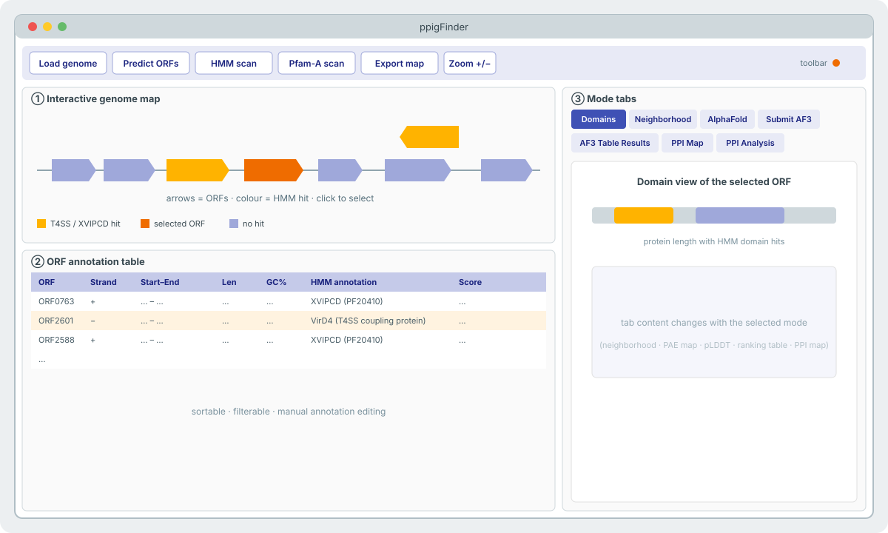
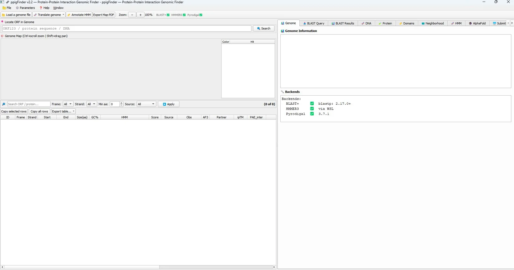
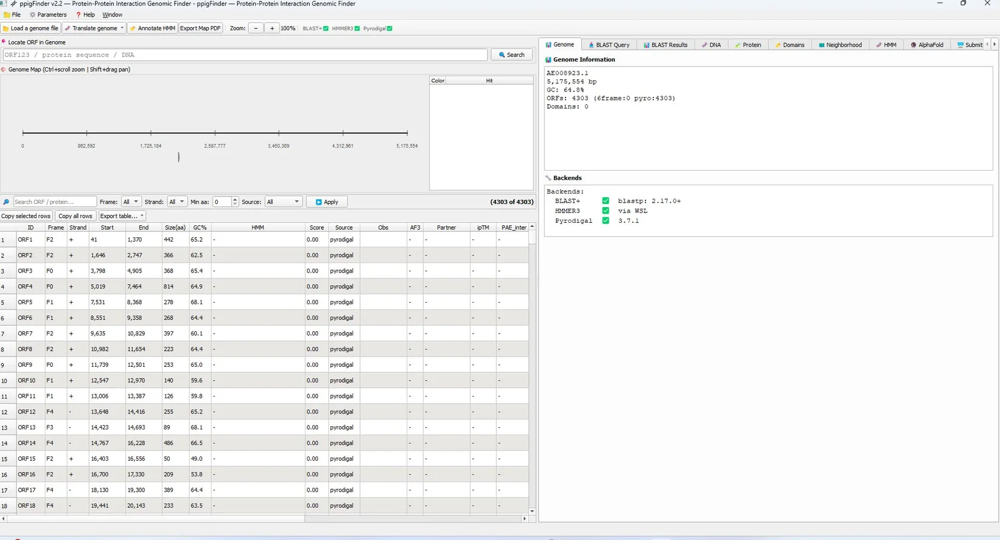
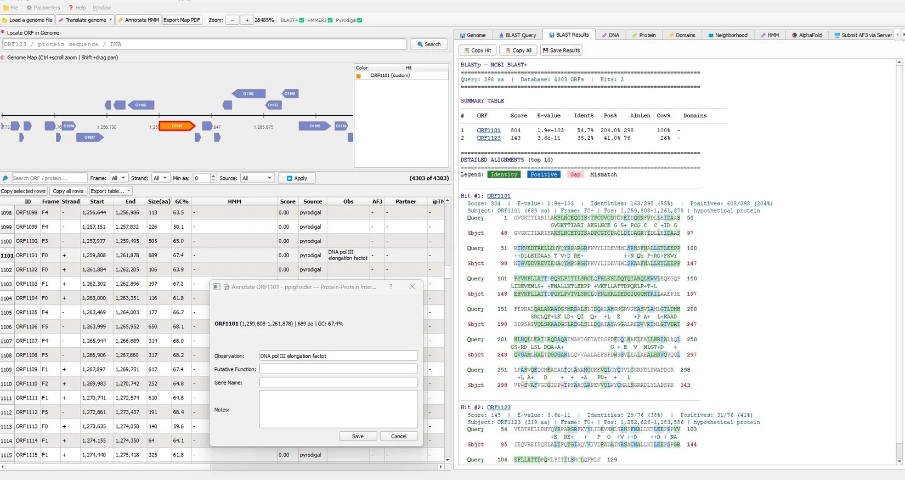
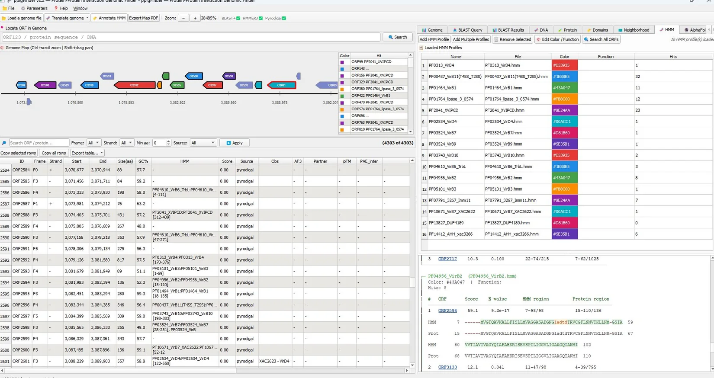
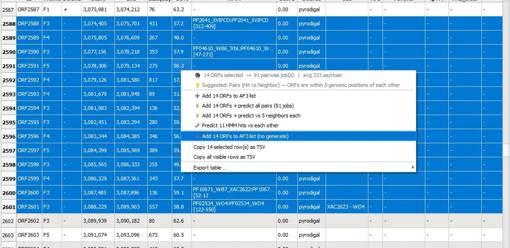
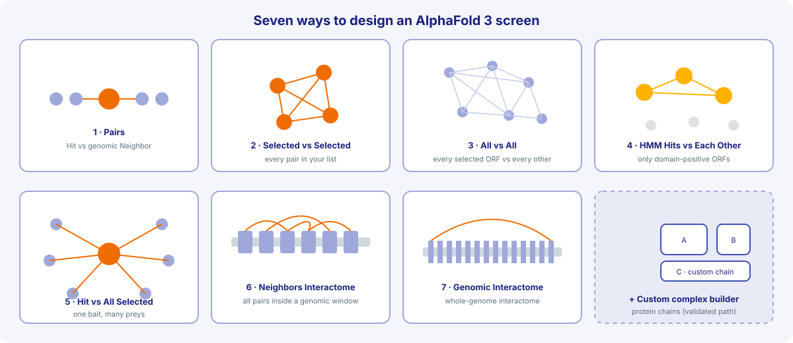

# Interface tour

The imported ppigfinder application is a Python/PyQt desktop program. This page distinguishes an **illustrative window diagram** from **real screenshots in the original v2.2 user guide**. Before following a menu sequence, check the version displayed in your application.

## Main regions

| Region | Function |
|---|---|
| Toolbar and menus | Open a genome, translate/predict ORFs, access annotation and export features. |
| Genome map | Examine genomic coordinates, strand direction and local context. |
| ORF table | Filter and select predicted ORFs, sequence details and annotation records. |
| Analysis tabs | Inspect genome, BLAST, HMM, AlphaFold jobs, results and other views, depending on version. |

## Earlier screenshots (v2.2)

### Startup and backend indicators

The screenshot shows an older UI with status indicators for optional external tools. A green indicator means the corresponding backend was detected in that environment, not that all modes or versions were validated.

### ORF prediction

### BLAST and HMM

### Selecting interaction jobs

## PPI design strategies

The seven strategies above reflect **concepts in the supplied visual guide**. Availability and exact labels vary between program versions. The generic structural-prediction input writer currently implements protein targets; **do not assume that DNA/RNA or ligand writers are fully available**.

## Next steps

Continue to the [complete guide](complete_guide.md), [AlphaFold / PPI workflows](alphafold.md), or [Xanthomonas example](../tutorials/xanthomonas.md).
